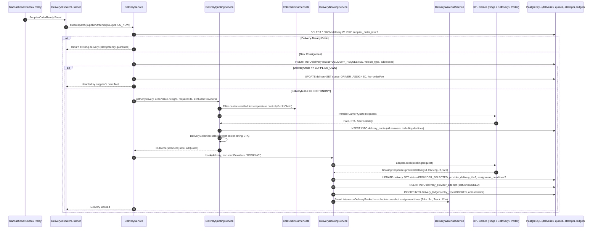
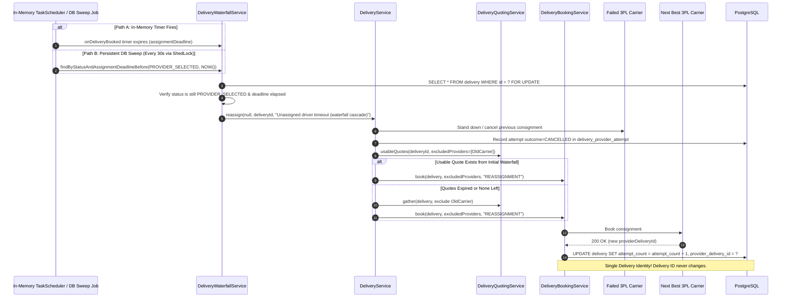
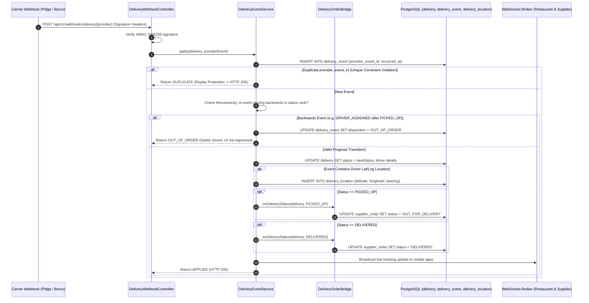
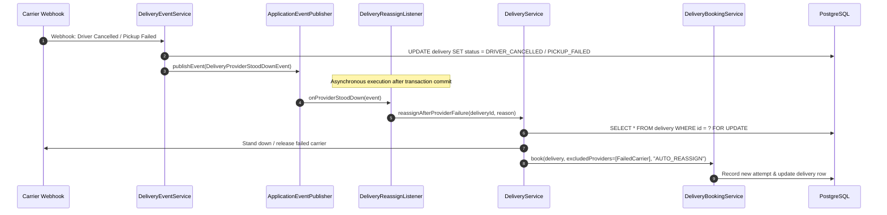
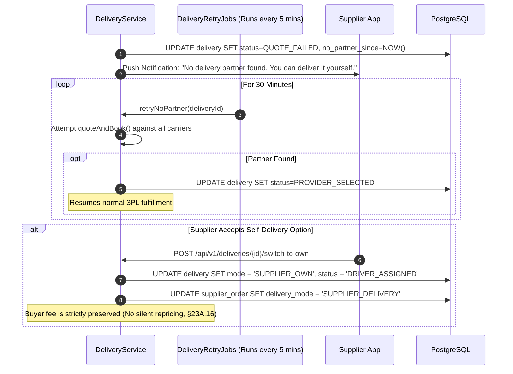
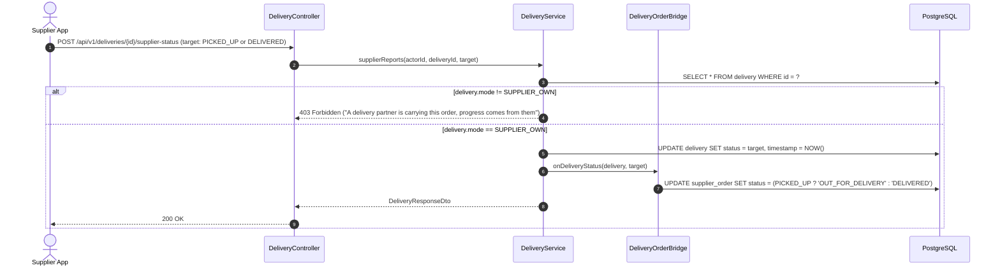
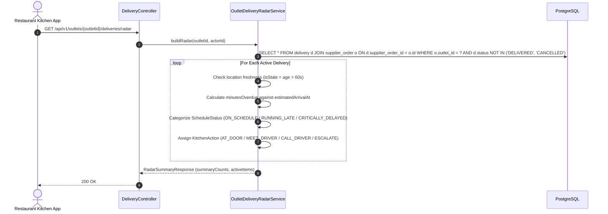
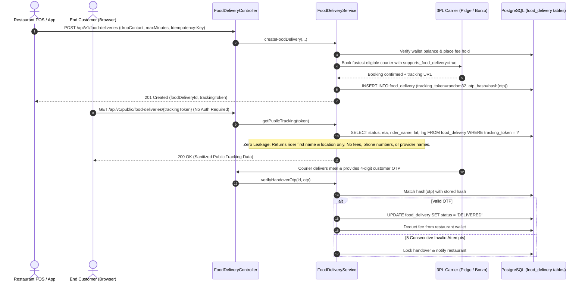

# Architecture Sequence Diagrams: Delivery & Logistics Module

This document details the exact runtime request/response sequence diagrams for all flows in the **Delivery & Logistics** module, reflecting the current production implementation (including multi-carrier waterfall, persistent assignment sweeps, and D-201 food delivery).

---

## 1. Automated Dispatch & Multi-Carrier Waterfall Quoting/Booking
**Trigger**: A warehouse or kitchen event (`SupplierOrderReady`) is published via the transactional outbox relay, or an authorized actor calls `POST /api/v1/supplier-orders/{orderId}/delivery`.

---

## 2. Assignment SLA Enforcement: In-Memory Timer & Persistent Database Sweep
**Trigger**: Carrier fails to assign a driver within the SLA timeout window (3m for two-wheelers, 12m for trucks/three-wheelers). Handled via both an in-memory timer and a 30-second persistent database sweep ([`DeliveryAssignmentSweepJob`](file:///Users/rac/Documents/costonomy_projects/marketplace_be/costonomy-mp-api/src/main/java/com/costonomy/mp/delivery/service/DeliveryAssignmentSweepJob.java)) to ensure resilience against server restarts.

---

## 3. Real-Time Telemetry & Monotonic Webhook Ingestion
**Trigger**: Incoming webhook from carrier (e.g., Pidge, Borzo) with driver updates, pickup, in-transit telemetry, or delivery confirmation.

---

## 4. Automatic Driver Stand-Down & Reassignment
**Trigger**: Driver cancels after assignment (`DRIVER_CANCELLED`) or pickup fails (`PICKUP_FAILED`). Handled event-driven via [`DeliveryReassignListener`](file:///Users/rac/Documents/costonomy_projects/marketplace_be/costonomy-mp-api/src/main/java/com/costonomy/mp/delivery/service/DeliveryReassignListener.java).

---

## 5. "No Partner Found" 30-Minute Recovery & Switch to Supplier Own (D-185)
**Trigger**: All carriers fail quoting or decline booking.

---

## 6. Supplier Own Delivery Milestone Reporting
**Trigger**: Supplier reports milestone on an order where `DeliveryMode == SUPPLIER_OWN`. Guardrail §23A.38 forbids suppliers from calling this endpoint for `COSTONOMY` deliveries.

---

## 7. Kitchen Radar Urgency Classification
**Endpoint**: `GET /api/v1/outlets/{outletId}/deliveries/radar`

---

## 8. Food Delivery (B2C) Parallel Flow (D-201)
**Endpoints**: `POST /food-deliveries`, `GET /api/v1/public/food-deliveries/{trackingToken}`, and 4-digit handover OTP.

