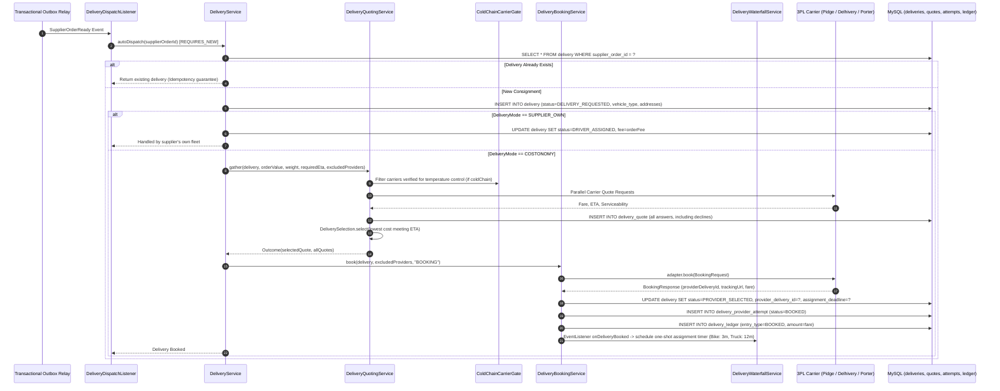
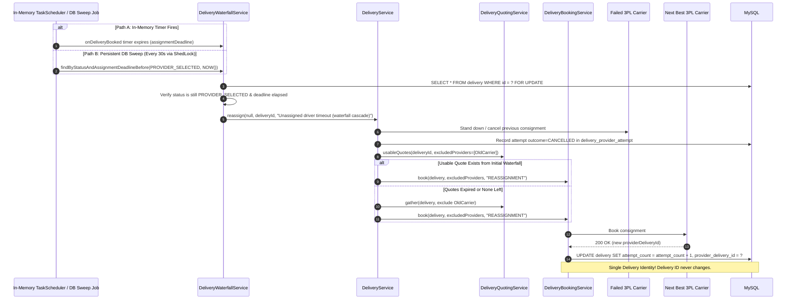
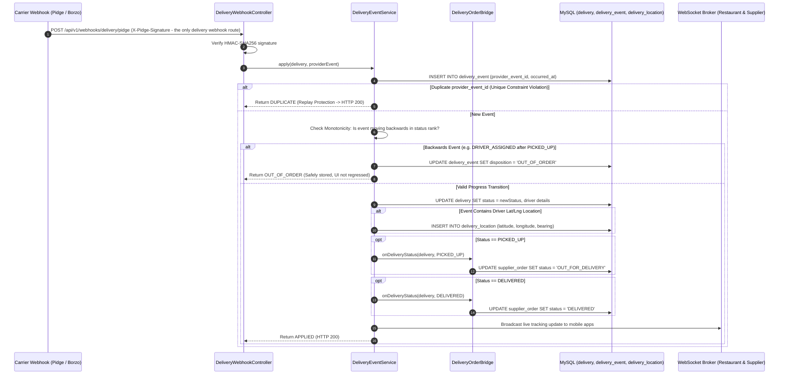
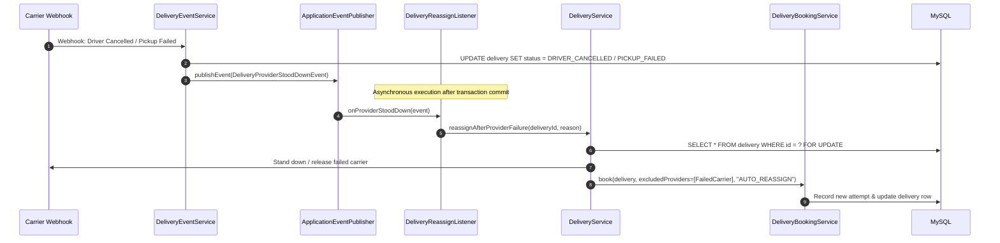
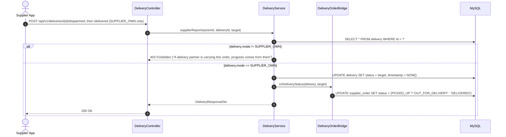
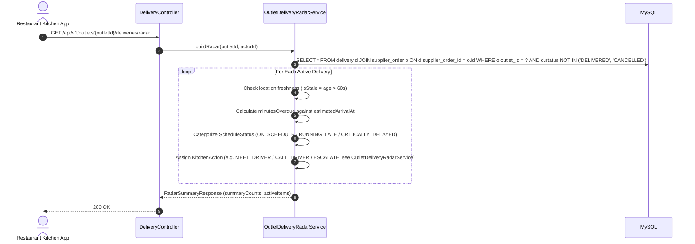
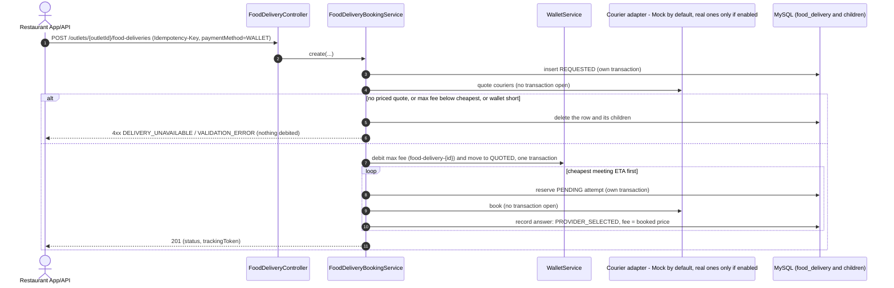
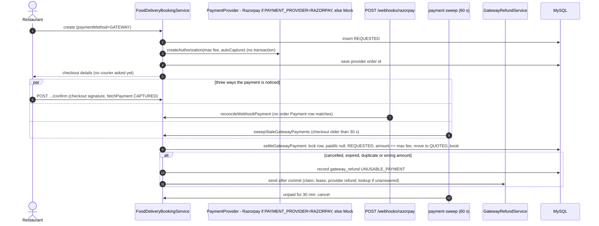
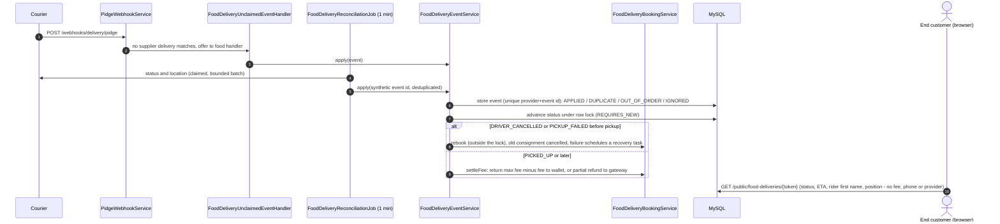

# Architecture Sequence Diagrams: Delivery & Logistics Module

This document details the exact runtime request/response sequence diagrams for all flows in the **Delivery & Logistics** module, as implemented in the code at 2026-10-25 (multi-carrier waterfall, persistent assignment sweeps, D-201 food delivery).

> **Status.** These sequences follow the code; they say nothing about what is deployed (no deployment evidence exists in the repo). Money and failure paths (no-partner retry, takeover, courier payable, gateway refunds, ops resolution) are **not** drawn here — see [`docs/delivery/DIAGRAMS.md`](../../delivery/DIAGRAMS.md) and [`docs/delivery/CURRENT_STATE.md`](../../delivery/CURRENT_STATE.md). Only the Pidge webhook route exists; other providers are polled. Database is MySQL.

---

## 1. Automated Dispatch & Multi-Carrier Waterfall Quoting/Booking
**Trigger**: A warehouse or kitchen event (`SupplierOrderReady`) is published via the transactional outbox relay, or an authorized actor calls `POST /api/v1/supplier-orders/{orderId}/delivery`.

---

## 2. Assignment SLA Enforcement: In-Memory Timer & Persistent Database Sweep
**Trigger**: Carrier fails to assign a driver within the SLA timeout window (3m for two-wheelers, 12m for trucks/three-wheelers). Handled via both an in-memory timer and a 30-second persistent database sweep ([`DeliveryAssignmentSweepJob`](../../../src/main/java/com/costonomy/mp/delivery/service/DeliveryAssignmentSweepJob.java)) to ensure resilience against server restarts.

---

## 3. Real-Time Telemetry & Monotonic Webhook Ingestion
**Trigger**: Incoming webhook from carrier (e.g., Pidge, Borzo) with driver updates, pickup, in-transit telemetry, or delivery confirmation.

---

## 4. Automatic Driver Stand-Down & Reassignment
**Trigger**: Driver cancels after assignment (`DRIVER_CANCELLED`) or pickup fails (`PICKUP_FAILED`). Handled event-driven via [`DeliveryReassignListener`](../../../src/main/java/com/costonomy/mp/delivery/service/DeliveryReassignListener.java).

---

## 5. "No Partner Found" 30-Minute Recovery & Switch to Supplier Own (D-185)
**Trigger**: All carriers fail quoting or decline booking.

---

## 6. Supplier Own Delivery Milestone Reporting
**Trigger**: Supplier reports milestone on an order where `DeliveryMode == SUPPLIER_OWN`. Guardrail §23A.38 forbids suppliers from calling this endpoint for `COSTONOMY` deliveries.

---

## 7. Kitchen Radar Urgency Classification
**Endpoint**: `GET /api/v1/outlets/{outletId}/deliveries/radar`

---

## 8. Food Delivery (B2C) Parallel Flow (D-201, D-204)
**Endpoints**: `POST /api/v1/outlets/{outletId}/food-deliveries`, `POST .../{id}/pay`, `POST .../{id}/confirm`, `POST .../{id}/cancel`, `GET .../{id}`, `GET .../{id}/timeline`, `GET .../{id}/financials`, and unauthenticated `GET /api/v1/public/food-deliveries/{trackingToken}`.
**Not built**: the 4-digit handover OTP check (hash fields exist on `FoodDelivery`; no verify method) and push/realtime events for food (deferred by decision D-205). **Operator exit**: `POST /api/v1/admin/food-deliveries/{id}/resolve` (cancel and refund, mark delivered, clear the flag; `DELIVERY_OPERATE`).

### 8a. Create, hold the fee, book (wallet path)

### 8b. Gateway-paid fee

### 8c. Courier events, public tracking, pickup settlement, cancel

Cancel before pickup refunds the whole held fee (wallet credit `food-delivery-{id}-refund`, or a gateway refund when paid at the gateway); cancel after pickup is refused; a failed delivery after pickup keeps the courier fee, and so does a provider `CANCELLED` after pickup (the delivery becomes `FAILED`, is flagged for an operator, and the courier stays owed). A provider `CANCELLED` or `DELIVERY_FAILED` before pickup stands the courier down and rebooks.
