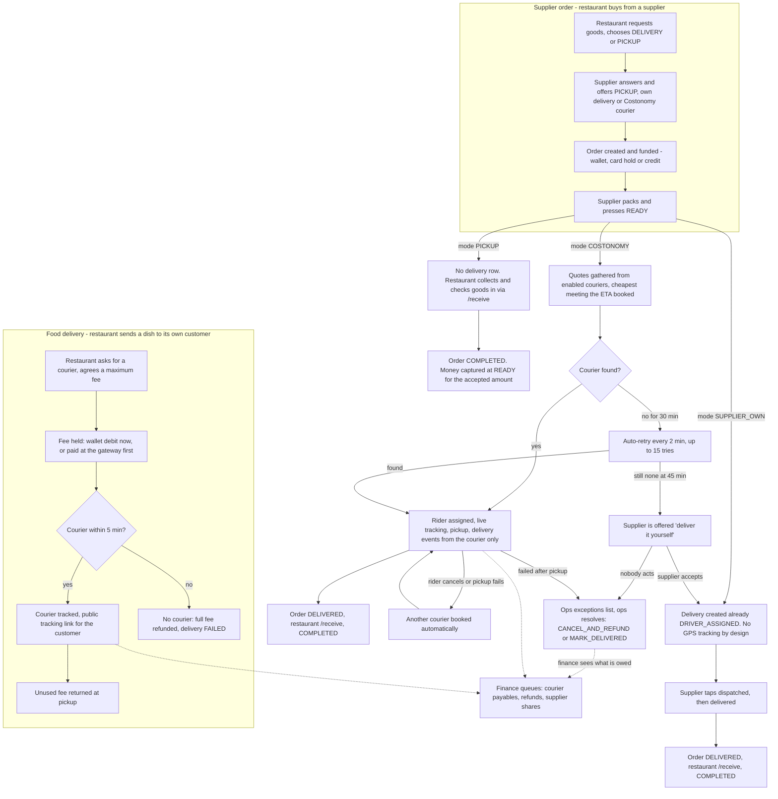
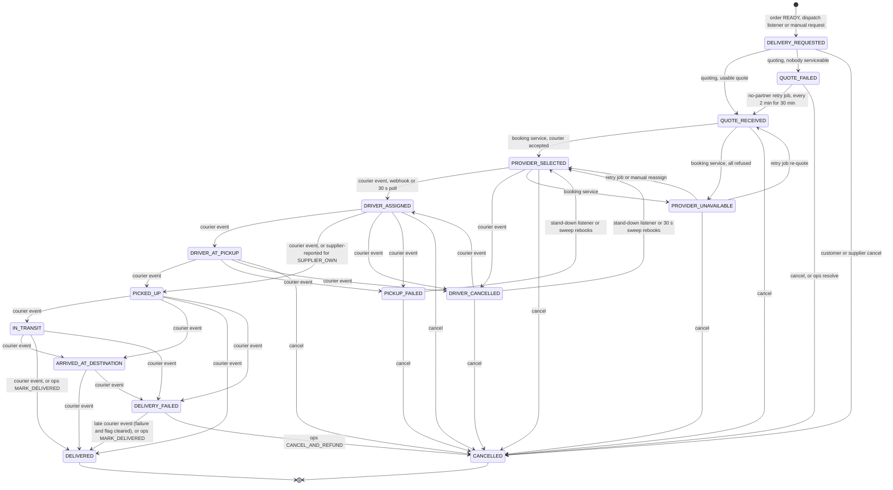
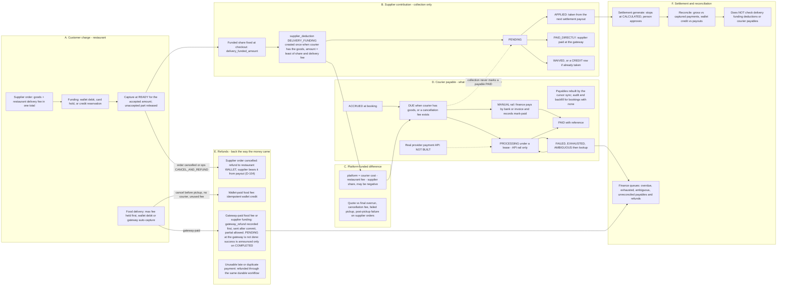

# Delivery diagrams — product, states, money, architecture

Authoritative diagrams for the delivery and delivery-money design. They describe **what the code in
this repository does** (snapshot: 2026-10-25, working tree of `costonomy-mp-api`). They say nothing
about what is deployed — no deployment evidence exists in either repo (see
[CURRENT_STATE.md §1](CURRENT_STATE.md#1-evidence-legend-and-scope)).

| # | Diagram | Audience | Status of what it shows |
|---|---|---|---|
| 1 | [Product journey](#1-product-journey) | product, support, ops | implemented in code; app-visibility differs per path (see the table under the diagram) |
| 2 | [Operational state machines](#2-operational-state-machines) | engineering, ops | exact enums and `allowedTransitions` from code |
| 3 | [Money movement](#3-money-movement) | finance, product, engineering | implemented; the courier-payment API rail is **not built** |
| 4 | [Production architecture](#4-production-architecture) | engineering, security | implemented as code; **no deployment evidence**; the diagram is the code's architecture, not a deployment topology |

The interactive visualizer (`delivery_interactive_visualizer.html`) is a **product walkthrough with
illustrative fares and four mock carriers**. It is not a source of truth for states, timings or money; use
this page.

Legend used in all diagrams: solid box = exists in code; dashed box = **not built, disabled by default,
sandbox-only or conceptual** (the node text says which).

---

## 1. Product journey

What a restaurant, a supplier and Costonomy operations experience, by delivery choice. The food-delivery
leg (restaurant → its own customer) is a **separate flow** with its own states and money (D-201).

Who sees what, today (code evidence; mobile column is from `costonomy-mp-mobile`, not from a release):

| Outcome | Restaurant | Supplier | Operations | Mobile app uses the API? |
|---|---|---|---|---|
| Pickup | order status only | order status only | order inspect | order screens only; receive flow not audited |
| Supplier-own | `DeliveryResponse` (no tracking) | dispatched / delivered buttons | `/admin/deliveries/**` | yes (`services/delivery.ts`) |
| Courier | tracking, driver, ETA, `retryUntil` | same, plus switch-to-own, reassign | inspect, ledger, force-waterfall, resolve, exceptions | yes, except cancel |
| Food delivery | `/outlets/{id}/food-deliveries/**`, `/financials`, public tracking | — | `/admin/food-deliveries/{id}/inspect`, alerts | **no usage found** |
| Courier payable, gateway refund | — | funding history/summary (supplier share only) | `/admin/delivery-finance/**` | **no usage found** |

---

## 2. Operational state machines

Three independent machines. They are deliberately **not** merged (see
[CURRENT_STATE.md §5](CURRENT_STATE.md#5-divergent-flows-and-their-boundaries)).

### 2a. Supplier-order delivery (`DeliveryStatus`)

Edges are the enum's `allowedTransitions` (`delivery/domain/DeliveryStatus.java:111-136`). The label names
who advances the edge. Terminal: `DELIVERED`, `CANCELLED` only. Recoverable failures: `QUOTE_FAILED`,
`PROVIDER_UNAVAILABLE`, `DRIVER_CANCELLED`, `PICKUP_FAILED`, `DELIVERY_FAILED`. The last is **operator-only by design**:
the goods were collected, so it is flagged for operations (`reconciliation_required`), never rebooked, and ends by a late
courier `DELIVERED` event or by ops `resolve` (D-205, D-206).

Writes that **bypass** `canTransitionTo` (verified in code, so the diagram above is the enum, not every write):
`switchToOwn` sets `DRIVER_ASSIGNED` from `QUOTE_FAILED`/`PROVIDER_UNAVAILABLE` (mode flips to `SUPPLIER_OWN`);
the booking service writes `PROVIDER_SELECTED`/`PROVIDER_UNAVAILABLE` directly; `SUPPLIER_OWN` rows are created
at `DRIVER_ASSIGNED`. Two enum edges are unreachable from provider events because the rank check marks them
`OUT_OF_ORDER`: `DELIVERY_FAILED → IN_TRANSIT` and `PICKUP_FAILED → DRIVER_ASSIGNED`.

Rules the code enforces beyond the enum (each with a test; see [CURRENT_STATE.md §6.1](CURRENT_STATE.md#6-known-gaps-and-risks)):

- **`DELIVERY_FAILED → PROVIDER_SELECTED` is in the enum but refused** by manual reassign (`pickedUpAt` set or status
  `DELIVERY_FAILED`): a second courier would be sent to goods already collected.
- **A late `DELIVERED` supersedes a failure.** The delivery moves to `DELIVERED`; `failure_code`, `failure_reason` and
  `reconciliation_required` are cleared, the attempt's end cause becomes `COMPLETED`, and `DELIVERY_FAILURE_SUPERSEDED` is
  audited. The `DeliveryFailed` and `DeliveryDelivered` events stay on record. (D-206)
- **The assignment timer and sweep release a driver only** if, under the row lock, the delivery is still `PROVIDER_SELECTED`,
  past its deadline, holds a courier, is not flagged, has no pending attempt, and the order is `READY_FOR_PICKUP`.
  Reads (`GET /deliveries/{id}`) never reassign.
- **A delivery cannot be cancelled on its own while its order is active** (`cancelOrder=false` is refused): the order would
  be left ready with nothing that can rebook. Cancel the order, reassign, or switch-to-own. It is accepted once the order has
  ended. Switch-to-own and the automatic retry are also refused while a delivery is flagged, so a booking whose outcome is
  unknown never gets a second courier.
- **`DeliveryResponse.underReview`** tells tenants (without the reason) that operations is looking at it; the apps show it
  and offer no retry.

The order moves with the delivery only through `DeliveryOrderBridge`: `PICKED_UP` → order `OUT_FOR_DELIVERY`,
`DELIVERED` → order `DELIVERED` (compare-and-set on the order status). The restaurant's `/receive` completes it.

### 2b. Food delivery (`FoodDeliveryStatus`)

Edges from `fooddelivery/domain/FoodDeliveryStatus.java:105-123`. Terminal per `isTerminal`: `DELIVERED`,
`CANCELLED`, `RETURNED`. `QUOTE_FAILED` is in the enum but **no main code sets it** (a failed quote at create deletes
the row and throws); `RETURNED` is set only by the operator's `resolve` (D-205).

```mermaid
stateDiagram-v2
    [*] --> REQUESTED: restaurant POST food-deliveries
    REQUESTED --> QUOTED: wallet debit of max fee, or gateway payment settled
    REQUESTED --> CANCELLED: restaurant cancel, or unpaid gateway checkout expires at 30 min
    QUOTED --> PROVIDER_SELECTED: booking service, courier accepted
    QUOTED --> PROVIDER_UNAVAILABLE: nobody left to ask
    QUOTED --> CANCELLED: restaurant cancel
    PROVIDER_UNAVAILABLE --> QUOTED: retry job, 30 s poll, within 5 min
    PROVIDER_UNAVAILABLE --> PROVIDER_SELECTED: retry or rebook
    PROVIDER_UNAVAILABLE --> FAILED: retry job after 5 min, NO_COURIER, full refund
    PROVIDER_UNAVAILABLE --> CANCELLED: restaurant cancel
    PROVIDER_SELECTED --> PROVIDER_SELECTED: rebook, assignment timeout 3 min, rider cancelled, pickup failed
    PROVIDER_SELECTED --> DRIVER_ASSIGNED: courier event, Pidge webhook or 1 min poll
    PROVIDER_SELECTED --> CANCELLED: restaurant cancel
    DRIVER_ASSIGNED --> AT_PICKUP: courier event
    DRIVER_ASSIGNED --> PICKED_UP: courier event
    DRIVER_ASSIGNED --> CANCELLED: restaurant cancel
    AT_PICKUP --> PICKED_UP: courier event, unused fee returned
    AT_PICKUP --> CANCELLED: restaurant cancel
    PICKED_UP --> OUT_FOR_DELIVERY: courier event
    PICKED_UP --> DELIVERED: courier event
    PICKED_UP --> FAILED: courier event DELIVERY_FAILED, courier fee kept
    OUT_FOR_DELIVERY --> ARRIVED: courier event
    OUT_FOR_DELIVERY --> DELIVERED: courier event
    OUT_FOR_DELIVERY --> FAILED: courier event
    ARRIVED --> DELIVERED: courier event
    ARRIVED --> FAILED: courier event
    FAILED --> DELIVERED: late courier event (failure and flag cleared), or ops MARK_DELIVERED
    FAILED --> RETURNED: ops CANCEL_AND_REFUND (returns the restaurant its fee; Costonomy bears the courier)
    DELIVERED --> [*]
    CANCELLED --> [*]
    RETURNED --> [*]
```

Not shown: a provider `CANCELLED` event **before pickup** stands the consignment down and rebooks (no refund, hold kept); **after
pickup** it moves the delivery to `FAILED` (`PROVIDER_CANCELLED_POST_PICKUP`), flagged for operations, with nothing refunded
and the courier payable `DUE` (`FoodDeliveryOperationsRecoveryIT`). A food delivery with no courier queues a durable wallet
refund task in its transaction and makes the wallet call after commit.
`FAILED` is not terminal in code; `FAILED → OUT_FOR_DELIVERY` is in the enum but a provider event for it would be stored `OUT_OF_ORDER`.

### 2c. Linked money states (advanced by jobs and finance, not by the delivery)

These are the states other diagrams refer to. Each is its own lifecycle, linked by delivery id.

| Lifecycle | States (code) | Advanced by |
|---|---|---|
| `courier_payable` | `ACCRUED → DUE → PROCESSING → PAID`; `FAILED` (retry), `EXHAUSTED` (person), `AMBIGUOUS` (lookup), `VOID` | `CourierPayableService.sync` after commit; **rebuilt by `CourierPayableSyncService`**, a durable cursor over each source's deliveries in `(updated_at, id)` order (oldest first, no lookback), with an audit of bookings that have no payable and an operator backfill (D-206); `CourierPaymentService` for API rails; finance for `MANUAL` |
| `gateway_refund` | `REQUESTED → SENDING → SUCCEEDED`; **`PENDING`** (the gateway accepted it, not finished: refund id stored, asked about until `COMPLETED` → `SUCCEEDED` or `FAILED` → retried as a new refund under a new key; the gateway's `refund.*` webhooks move it sooner when they match by payment id plus refund id or receipt, the poll is the fallback); `FAILED` (retry), `EXHAUSTED`, `AMBIGUOUS` | `GatewayRefundService.sendSoon` after commit, `GatewayRefundJobs` sweep, finance retry/resolve |
| `supplier_deduction` | `PENDING → APPLIED` (taken in a settlement) or `PAID_DIRECTLY` (gateway); `WAIVED` | `SupplierRefundLedger.applyPending` at settlement, `SupplierDeliveryFundingPaymentService.recordDirectPayment`, `SupplierFundingCorrection` |
| `settlement` | `PENDING → CALCULATED → APPROVED → PROCESSING → PAID`; `FAILED` | `SettlementJobs` stop at `CALCULATED`; a person approves |

---

## 3. Money movement

Separate lifecycles, linked by order and delivery id. **Collecting from a supplier is not paying a courier**:
the supplier lifecycle (B) ends in a deduction or a direct payment; the courier lifecycle (D) is paid by a
separate step that no supplier collection can complete. Only the `MANUAL` and `MOCK_API` courier rails exist.

Rules the diagram encodes (each with its evidence in [CURRENT_STATE.md §3](CURRENT_STATE.md#3-money-per-journey-and-failure-exits)):

- The restaurant's delivery fee and the supplier's agreed share are **fixed at checkout** and never silently repriced.
  A supplier is never charged more than the courier cost or more than agreed (`CourierPayableService.apply`, D-204 §3).
- **Post-pickup failure:** on a supplier order the customer is refunded by ops resolution and the courier stays owed;
  on a food delivery the restaurant keeps paying the courier's fee and nothing is refunded, unless an operator
  decides otherwise (`resolve` with `CANCEL_AND_REFUND` returns the fee and Costonomy bears the courier).
- **A refund is done when the gateway says `COMPLETED`**, not when it accepts the request: `PENDING` is kept and
  reconciled, a later `FAILED` is visible in the finance queue and retried under a new idempotency key, and the
  customer's `refundState` stays `IN_PROGRESS` meanwhile.
- A supplier deduction is taken by the settlement **or** paid directly, never both; a payment that loses that race
  is refunded through the gateway-refund workflow.
- Reconciliation records a mismatch, never blocks (D-055); it does not cover lifecycles B or D.

---

## 4. Production architecture

Code architecture of the modular monolith (Spring Boot 3.2, Java 17, MySQL 8, Flyway). It marks transaction
and external-call boundaries and recovery paths. It is **not** a deployment diagram: no Dockerfile, IaC,
`application-prod*` or release record exists in the repo; the only pipeline is `.github/workflows/ci.yml`
(`mvn verify`). Redis, ShedLock and outbox are in the code; whether production runs them is unknown.

```mermaid
flowchart TB
    subgraph Clients["Clients"]
        MOB["Mobile app - restaurant and supplier"]
        PUB["Public tracking link - unauthenticated, rate limited"]
        OPSWEB["Ops and finance - API only, no admin UI in either repo"]
    end

    subgraph API["REST APIs - /api/v1"]
        DC["Delivery: /supplier-orders/id/delivery, /deliveries/id/*"]
        FC["Food: /outlets/id/food-deliveries/*, /public/food-deliveries/token"]
        SC["Supplier funding: /supplier-stores/id/delivery-funding/*"]
        AC["Admin and operator exits: /admin/deliveries - resolve, close-pickup, exceptions, force-waterfall; /admin/food-deliveries - inspect, resolve; /admin/delivery-finance; /admin/settlements"]
        WH["Webhooks: /webhooks/delivery/pidge, /webhooks/razorpay"]
    end

    subgraph SVC["Application services - one DB transaction each, short, no network call inside"]
        DS["DeliveryService, BookingService, EventService, OrderBridge"]
        FS["FoodDeliveryBookingService, EventService, QueryService"]
        PS["PaymentService, RefundService, GatewayRefundService, WalletService"]
        CS["CourierPayableService, CourierPaymentService"]
        ST["SettlementService, SupplierRefundLedger, SupplierDeliveryFundingPaymentService"]
    end

    subgraph DB["MySQL 8 - transactional truth, Flyway V1 to V105"]
        T1["delivery, delivery_provider_attempt, delivery_quote, delivery_event, delivery_ledger"]
        T2["food_delivery and quote, attempt, event, location"]
        T3["payment, refund, gateway_refund, gateway_refund_reservation, wallet"]
        T4["courier_payable, courier_payment_attempt, courier_payable_event, courier_payable_sync_cursor"]
        T5["supplier_deduction, settlement"]
        T6["outbox_event, delivery_recovery_task, shedlock, audit_log"]
    end

    subgraph JOBS["Scheduled jobs - ShedLock, claim by conditional UPDATE then call outside the transaction"]
        J1["Dispatch sweep, assignment sweep 30 s, no-partner retry 1 min, poll 30 s"]
        J2["Food: retry 30 s, assignment sweep, stale-attempt sweep, payment sweep 60 s, reconciliation poll 1 min"]
        J3["Courier payable sync cursor + payments 1 min, payable audit 15 min, gateway refund send and pending check 30 s, recovery tasks 30 s"]
        J4["Settlement generate and reconcile hourly, delivery-funding sweep 60 s, payment jobs"]
    end

    subgraph OBX["Outbox and events"]
        O1["OutboxPublisher drain 2 s, FOR UPDATE SKIP LOCKED, 10 attempts"]
        O2["DeliveryDispatchListener on SupplierOrderReady"]
        O3["RealtimeEventRelay, NotificationRelay"]
        O4["In-process after-commit events: DeliveryProviderStoodDownEvent, GatewayRefundOutcome, SupplierShareReduced"]
        O5["In-memory one-shot timer: DeliveryWaterfallService, lost on restart, backed by the 30 s sweep"]
    end

    subgraph EXT["External adapters - ports, called with NO transaction open"]
        E1["Courier: MOCK default; PIDGE real HTTP when selected; 8 more real adapters off by default, polled only"]
        E2["Customer payments: Razorpay real when PAYMENT_PROVIDER=RAZORPAY, Mock default"]
        E3["Courier payment rail: MANUAL default, MOCK_API tests only. Real provider payment API: NOT BUILT"]
    end

    MOB --> DC
    MOB --> FC
    MOB --> SC
    PUB --> FC
    OPSWEB --> AC
    DC --> DS
    FC --> FS
    SC --> ST
    AC --> DS
    AC --> CS
    AC --> PS
    WH --> DS
    WH --> PS
    WH --> FS
    DS --> T1
    FS --> T2
    PS --> T3
    CS --> T4
    ST --> T5
    DS --> T6
    DS --> O1
    O1 --> O2
    O1 --> O3
    O2 --> DS
    DS -.->|"after commit"| O4
    DS -.->|"in-memory"| O5
    J1 --> DS
    J2 --> FS
    J3 --> CS
    J3 --> PS
    J4 --> ST
    J4 --> PS
    DS -->|"book, quote, cancel, poll"| E1
    FS -->|"book, quote, cancel, poll"| E1
    PS -->|"authorize, capture, refund, inspect"| E2
    CS -->|"pay, lookup"| E3
    CS -.->|"payable created from deliveries after commit, rebuilt by sweep"| T1
```

Transaction and recovery patterns that recur (each verified in code; see
[CURRENT_STATE.md §4](CURRENT_STATE.md#4-duplicated-triggers-and-race-control) for the claim details):

1. **Record, commit, then call.** Gateway refund: `record` in the caller's transaction → `sendSoon` registered as an
   after-commit hook → `send` claims `REQUESTED/FAILED → SENDING` with a lease → provider call with no transaction →
   outcome written only if the claim token is still ours (`LEASE_LOST` otherwise).
2. **Claim, call, record.** Courier payment, courier booking and stale-attempt recovery follow the same shape; an
   unknown outcome becomes `AMBIGUOUS` and is resolved by a lookup by idempotency key/reference, never by repeating the call.
3. **Derived, rebuildable records.** `courier_payable` is derived by an idempotent `sync` after commit and by a cursor
   sweep that visits every delivery in `(updated_at, id)` order (a changed delivery moves to the end of the order, a visited
   one is not revisited, there is no lookback window). A row that fails is retried for three passes and then skipped
   loudly and listed; an audit counts bookings with no payable (gauge `courier.payable.sync.missing`, log ALERT) and
   `POST /admin/delivery-finance/payables/backfill` repairs them page by page.
4. **Durable cancellation.** A failed provider cancel becomes a `delivery_recovery_task` (max 5 attempts, lease, backoff).
5. **Event stored with its effect.** A provider event is inserted (`INSERT IGNORE`, unique on provider and event id) in the
   same transaction as the status change: a duplicate is "0 rows" and detected, an out-of-order event is stored
   `OUT_OF_ORDER`, and a failed apply rolls the row back, so the provider's retry is applied rather than refused as a
   duplicate (D-205).
6. **Accepted is not done.** A gateway refund the provider answers `PENDING` is stored with the provider's refund id and
   asked about until `COMPLETED` or `FAILED`; only `COMPLETED` publishes the success outcome (D-206).
