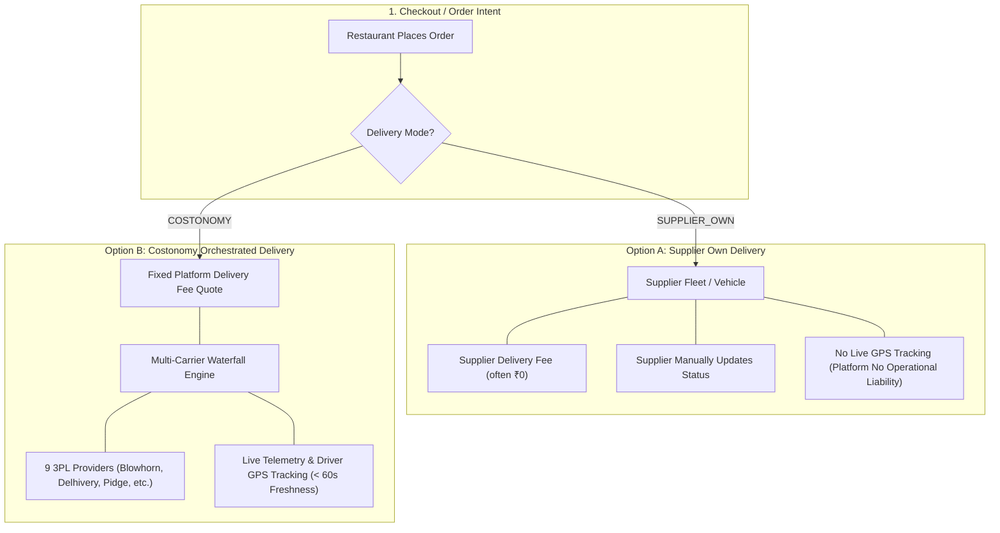
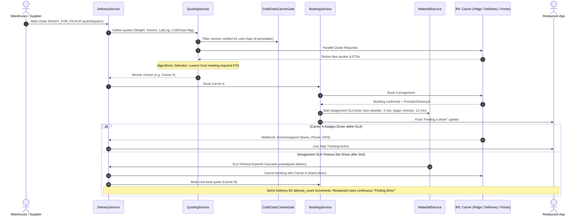
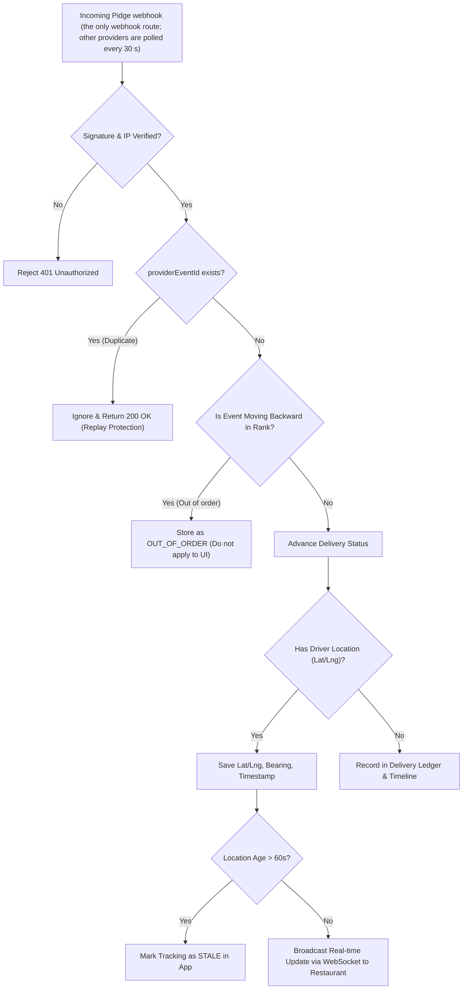
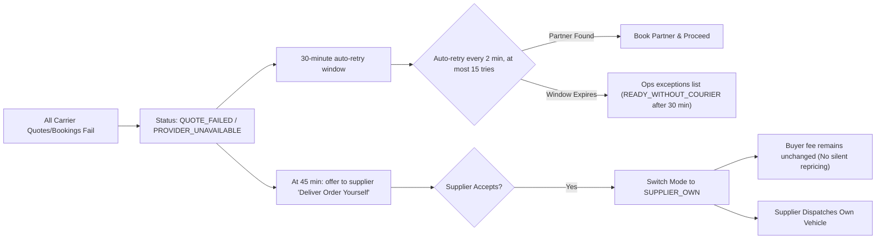

# Costonomy Delivery Module — Product Team Blueprint & Visual Guide

This document visualizes the end-to-end architecture, lifecycle state machine, carrier waterfall orchestration, and operational guardrails of the **Costonomy Delivery Module**.

> **Orientation guide, corrected 2026-10-25.** It covers the supplier-order delivery journey only. For exact states, money movement, food delivery and what is tested/deployed/app-visible, use [DIAGRAMS.md](DIAGRAMS.md) and [CURRENT_STATE.md](CURRENT_STATE.md). Nothing here implies deployment (no deployment evidence exists).

---

## 1. Executive Summary & Core Delivery Modes

The delivery engine is designed to be **provider-agnostic**, ensuring restaurants and suppliers experience a uniform Mandi order journey regardless of who physically transports the goods.

### Key Differences at a Glance

| Feature | Supplier Own (`SUPPLIER_OWN`) | Costonomy Orchestrated (`COSTONOMY`) |
| :--- | :--- | :--- |
| **Who Transports** | Supplier's own staff or private vehicle | 3PL Partner (Blowhorn, Delhivery, Pidge, Porter, etc.) |
| **Pricing to Buyer** | Set by supplier (typically free ₹0) | Quoted platform fee based on weight, distance & vehicle |
| **Carrier Bids** | N/A | Strictly internal (hidden from restaurant & supplier) |
| **State Progression** | Supplier reports pickup & delivery | Driven strictly by courier webhooks/events (§23A.38) |
| **Live Tracking** | Disabled (prevents fake location generation) | Full GPS map tracking, speed, bearing & ETA |
| **SLA Responsibility**| Supplier bears full operational responsibility | Costonomy platform orchestrates retries & reassignment |

---

## 2. End-to-End Delivery Lifecycle & State Machine

Provider events cannot rewind progress (they are stored `OUT_OF_ORDER` instead), and most non-terminal failures trigger automatic cascading rather than failing the order.

The exact state diagram, with the actor or job that advances each edge, is in [DIAGRAMS.md §2a](DIAGRAMS.md#2a-supplier-order-delivery-deliverystatus). (The diagram previously drawn here showed edges the code does not allow, such as `QUOTE_FAILED → DRIVER_ASSIGNED`, `PROVIDER_SELECTED → PROVIDER_SELECTED` and `DELIVERY_FAILED → IN_TRANSIT` by event; supplier takeover writes `DRIVER_ASSIGNED` directly and flips the mode.)

### State Classification

*   **Initial:** `DELIVERY_REQUESTED`
*   **Carrier Quoting & Selection:** `QUOTE_RECEIVED`, `PROVIDER_SELECTED`
*   **Execution & Fulfillment:** `DRIVER_ASSIGNED`, `DRIVER_AT_PICKUP`, `PICKED_UP`, `IN_TRANSIT`, `ARRIVED_AT_DESTINATION`
*   **Recoverable Setbacks (Auto-cascade/reassign):** `QUOTE_FAILED`, `PROVIDER_UNAVAILABLE`, `DRIVER_CANCELLED`, `PICKUP_FAILED`
*   **Operator-only setback:** `DELIVERY_FAILED` (after pickup, the goods are with the courier)
*   **Terminal States (Only 2):** `DELIVERED`, `CANCELLED`
*   Note: `DELIVERY_FAILED` is never rebooked automatically and manual reassign is refused; it is flagged for review and operations resolves it (`POST /api/v1/admin/deliveries/{id}/resolve`: cancel and refund, or mark delivered).

---

## 3. Carrier Selection & Waterfall Cascading Engine

Costonomy has adapters for 9 logistics providers (Pidge, Borzo, Shadowfax, Porter, Shiprocket, LoadShare, Blowhorn, Delhivery, Xpressbees). Only Pidge is a real adapter by default when `providers.delivery=PIDGE`; the other eight are off by default, and the mock couriers are the default. When an order is ready, enabled providers are queried and the cheapest usable quote is booked first.

### Selection Rules

1.  **Strictly Lowest Cost meeting ETA**: Commission or margin plays zero part. Guardrail ensures the platform does not pass higher fees to buyers.
2.  **Fallback to Fastest**: If no courier meets the required ETA, the system selects the fastest available courier, prioritizing arrival over price.
3.  **Vehicle Type Classification**:
    *   `TWO_WHEELER`: up to 20 kg
    *   `THREE_WHEELER`: 20 kg – 100 kg
    *   `FOUR_WHEELER_TRUCK`: over 100 kg (`VehicleType.java`)
4.  **Intra-City Radius Gate**: Capped at 30 km max radius. Orders beyond 30 km are flagged `UNSERVICEABLE` before external queries.
5.  **Cold Chain Verification**: For temperature-sensitive perishable items, carriers must hold verified cold-chain equipment for the specific vehicle category.

---

## 4. Live Tracking & Webhook Processing Pipeline

To provide a seamless Uber-like tracking experience, incoming webhook events from logistics partners are sanitized and deduplicated:

---

## 5. Failures & "No Partner Found" Fallback (D-185)

When no third-party logistics partner can accept the delivery (e.g., peak demand, severe weather, or remote location), Costonomy does not abandon the restaurant.

### Safety & Integrity Rules

*   **Single Delivery Identity (D-026)**: Cascading or switching to supplier-own mode **never** creates a second `delivery` row. The same delivery ID is maintained throughout so order history, invoices, and analytics remain consistent.
*   **No Silent Reprice (§23A.16)**: When switching from Costonomy to supplier-own delivery after a partner failure, the delivery fee paid by the buyer is preserved exactly as quoted at checkout.
*   **Strict Access Control (§23A.38)**: On Costonomy-managed deliveries, suppliers are blocked from manually clicking "Delivered". Only courier (3PL) events or an operator resolution can mark fulfillment; there is no delivery-OTP check in the code.

---

## 6. Summary for Product Roadmap & Operations

1.  **Buyer Experience**: Clean ETA countdown, real-time map with driver marker, and automatic indicator if GPS signal becomes stale (> 60s).
2.  **Supplier Experience**: Automated dispatch upon packing; one-tap fallback to own vehicle if 3PL network is congested.
3.  **Operations & Admin**: Full audit ledger showing every carrier quote, decline reason, waterfall cascade, and vehicle allocation.
